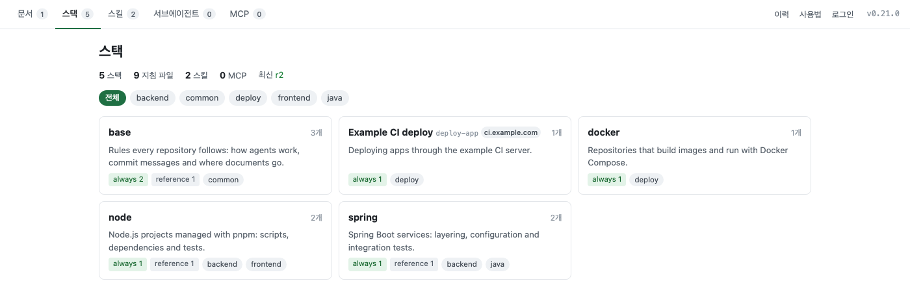

<!-- source: README.md @ v0.21.0 -->
[English](README.md) | **한국어**

# guideline-manage

공용 코딩 에이전트 지침을 지침 서버에 두고 ruler 프로젝트로 골라 받는 도구

[](https://www.npmjs.com/package/guideline-manage)
[](https://github.com/jang2162/guideline-manage/actions/workflows/ci.yml)
[](LICENSE)



## 소개

코딩 에이전트를 쓰는 팀은 스택별 규칙, 스킬, 서브에이전트, MCP 설정 같은 지침을 프로젝트마다 복사해 둡니다.
사본은 점점 서로 달라지고, 어느 프로젝트가 최신 규칙을 쓰는지 아무도 모르게 됩니다.
guideline-manage 는 원본 하나를 **지침 서버**에 두고, 프로젝트마다 `guideline` CLI 로 필요한 부분만 골라 받게 합니다.
프로젝트마다 받은 것을 기록하므로 CLI 가 원본과 프로젝트 중 어디가 바뀌었는지 알려 주고, 고친 내용은 검토를 거치는 제안으로 원본에 돌아갑니다.
[ruler](https://github.com/intellectronica/ruler)(`.ruler/`)로 CLAUDE.md, AGENTS.md 같은 에이전트 파일을 만드는 팀을 위한 도구입니다.

## 주요 기능

- 무엇이 같고 다르고 없는지 웹 폼에서 먼저 보고, 프로젝트마다 지침을 고릅니다.
- 프로젝트에서 고친 내용을 잃지 않고 `guideline update` 로 모든 프로젝트를 최신으로 맞춥니다.
- 받은 사본은 원본과 맞춰 둔 채, 한 프로젝트에서만 공용 규칙을 바꿉니다.
- 프로젝트에서 고친 내용을 제안으로 올리고, 관리자는 차이와 3-way merge 결과를 보고 검토합니다.
- 여러 서버의 지침을 한 프로젝트에 함께 받고, 겹치는 이름은 별칭으로 나눕니다.
- 에이전트에게 맡깁니다. 서버의 `/llms.txt` 와 `guideline-sync` 스킬이 지침 받기와 할 일 처리 방법을 알려 줍니다.
- CLI 와 관리자 웹을 영어나 한국어로 쓰고, 다른 언어는 언어팩으로 더합니다.

## 설치

요구 사항: Node 24 이상, ruler 를 쓰는 프로젝트.

```bash
npm install -g guideline-manage
```

설치를 확인하세요.

```bash
guideline help
```

출력의 첫 줄은 다음과 같습니다.

```text
사용법: guideline <명령> [옵션]
```

지침 서버는 이 저장소에서 Docker Compose 로 띄웁니다. [지침 서버 배포하기](docs/manual/ko/how-to/deploy-a-server.md)를 보세요.

## 빠른 시작

1. 머신마다 한 번 지침 서버에 로그인하세요. 브라우저가 열리면 **발급**을 누르세요.

   ```bash
   guideline login --server <YOUR_SERVER_URL>
   ```

   ```text
   로그인: <YOUR_SERVER_URL>/cli/login?callback=…
   로그인 성공: <YOUR_SERVER_URL> (cli-<호스트>-…)
   토큰 범위: read
   ```

2. ruler 프로젝트의 루트에서 폼을 열고, 지침을 고르고, 제출하세요.

   ```bash
   guideline pick --server <YOUR_SERVER_URL>
   ```

   CLI 가 `guideline.json` 에 서버 주소를 남기므로 두 번째부터는 `--server` 를 빼도 됩니다.

3. 터미널에 쓴 것과 남은 할 일이 나옵니다. 예를 들어 파일 세 개짜리 `base` 스택을 고르면 다음과 같습니다.

   ```text
   반영 완료(r2) — 쓴 파일 6, 지운 파일 0
     쓰기  .ruler/base/00-agent.md
     쓰기  .ruler/base/01-git.md
     쓰기  .ruler/base/99-reference.md
     쓰기  .ruler/guideline.md
     쓰기  docs/guideline/README.md
     쓰기  docs/guideline/base/02-docs.md
   ```

   바뀐 파일을 `guideline.json`·`guideline-lock.json` 과 함께 커밋하세요.

아직 서버가 없다면 [시작하기](docs/manual/ko/getting-started.md)에서 내 컴퓨터에 먼저 띄웁니다.

## 설정

CLI 와 서버는 환경 변수를 읽습니다. 가장 많이 바꾸는 것은 언어입니다.

| 항목 | 기본값 | 설명 |
| --- | --- | --- |
| `GUIDELINE_LANG` | `en` | CLI 메시지, 관리자 웹, 프로젝트에 쓰는 글의 언어. 한국어는 `ko`. CLI 와 서버에 각각 둡니다 |

모든 설정은 [설정](docs/manual/ko/configuration.md)에 있습니다.

## 문서

- [시작하기](docs/manual/ko/getting-started.md)
- [따라 하기 목록](docs/manual/README.md)
- [설정](docs/manual/ko/configuration.md)
- [레퍼런스](docs/manual/ko/reference.md)
- [문제 해결](docs/manual/ko/troubleshooting.md)
- [변경 기록](CHANGELOG.md)(영어)

## 기여하기

이슈와 풀 리퀘스트를 환영합니다. 개발 방법, 저장소 구조, 릴리스는 [CONTRIBUTING.md](CONTRIBUTING.md)(영어)를 보세요.

## 라이선스

MIT License. 자세한 내용은 [LICENSE](LICENSE) 를 보세요.
