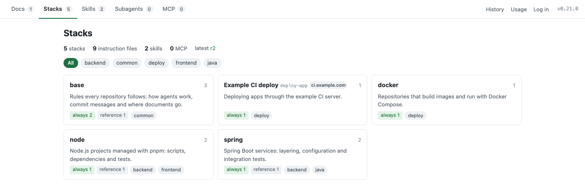

**English** | [한국어](README.ko.md)

# guideline-manage

Keep shared coding-agent guidelines on a guideline server and pick them into ruler projects

[](https://www.npmjs.com/package/guideline-manage)
[](https://github.com/jang2162/guideline-manage/actions/workflows/ci.yml)
[](LICENSE)



## Overview

Teams that use coding agents copy the same guidelines into every project: per-stack rules, skills, subagents and MCP settings.
The copies drift apart, and nobody knows which project has the latest rules.
guideline-manage keeps one source on a **guideline server**, and each project picks the parts it needs with the `guideline` CLI.
Every project records what it received, so the CLI can tell what changed in the source or in the project, and edits travel back as reviewed proposals.
It is for teams whose projects use [ruler](https://github.com/intellectronica/ruler) (`.ruler/`) to generate CLAUDE.md, AGENTS.md and other agent files.

## Features

- Choose guidelines per project in a web form that shows what is the same, different or missing before anything is written.
- Bring every project up to date with `guideline update` without losing edits made in the project.
- Override a shared rule in one project while the received copies stay in sync with the source.
- Send local edits upstream as proposals that an admin reviews with diffs and a 3-way merge.
- Combine guidelines from several servers in one project, with aliases for clashing names.
- Hand the work to an agent: the server's `/llms.txt` and the `guideline-sync` skill tell agents how to receive guidelines and handle to-dos.
- Run the CLI and the admin web in English or Korean, and add other languages with language packs.

## Installation

Requirements: Node 24 or later, and a project that uses ruler.

```bash
npm install -g guideline-manage
```

Verify the installation:

```bash
guideline help
```

The first line of the output is:

```text
Usage: guideline <command> [options]
```

The guideline server runs with Docker Compose from this repository. See [Deploy a guideline server](docs/manual/en/how-to/deploy-a-server.md).

## Quick Start

1. Log in to a guideline server once per machine. A browser opens; select **Issue**.

   ```bash
   guideline login --server <YOUR_SERVER_URL>
   ```

   ```text
   Log in: <YOUR_SERVER_URL>/cli/login?callback=…
   Logged in: <YOUR_SERVER_URL> (cli-<host>-…)
   Token scope: read
   ```

2. At the root of a ruler project, open the form, choose guidelines and submit.

   ```bash
   guideline pick --server <YOUR_SERVER_URL>
   ```

   Later runs can drop `--server`, because the CLI keeps it in `guideline.json`.

3. The terminal lists what was written and what is left to do. For example, choosing a `base` stack with three files prints:

   ```text
   Applied (r2) — 6 written, 0 deleted
     write  .ruler/base/00-agent.md
     write  .ruler/base/01-git.md
     write  .ruler/base/99-reference.md
     write  .ruler/guideline.md
     write  docs/guideline/README.md
     write  docs/guideline/base/02-docs.md
   ```

   Commit the changed files together with `guideline.json` and `guideline-lock.json`.

No server yet? [Getting Started](docs/manual/en/getting-started.md) starts one on your machine first.

## Configuration

The CLI and the server read environment variables. The one most people change is the language:

| Option | Default | Description |
| --- | --- | --- |
| `GUIDELINE_LANG` | `en` | Language of CLI messages, the admin web and text written into projects. `ko` for Korean. Set it for the CLI and the server separately |

Every option is listed in [Configuration](docs/manual/en/configuration.md).

## Documentation

- [Getting Started](docs/manual/en/getting-started.md)
- [How-to guides](docs/manual/README.md)
- [Configuration](docs/manual/en/configuration.md)
- [Reference](docs/manual/en/reference.md)
- [Troubleshooting](docs/manual/en/troubleshooting.md)
- [Changelog](CHANGELOG.md)

## Contributing

Issues and pull requests are welcome. See [CONTRIBUTING.md](CONTRIBUTING.md) for development, layout and releases.

## License

MIT License. See [LICENSE](LICENSE) for details.
