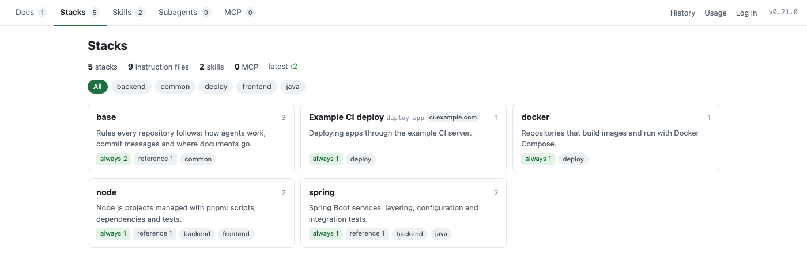

**English** | [한국어](../ko/getting-started.md)

# Getting started

This guide takes you from installing the `guideline` CLI to receiving your first guidelines in a project.
It is for developers whose projects use [ruler](https://github.com/intellectronica/ruler) and who are new to guideline-manage.

```text
guideline server (source DB) ── admin web: view, edit, history, tokens
        │
        ▼  guideline pick / update (logged-in CLI)
project: copies in .guideline/ + guideline.json (chosen items) + guideline-lock.json (what was applied)
        │
        ▼  guideline apply (no server needed; pick and update run it at their end)
generated files for ruler (.ruler/<stack>/, .ruler/guideline.md, docs/guideline/ …, git-ignored)
```

Agents can read the server's `/llms.txt` (for example `http://localhost:3000/llms.txt`), a condensed version of this manual for agents.

## Before you begin

- Node 24 or later.
- A project that uses ruler: its directory has a `.ruler/` folder. Without it, the CLI stops with "Not a ruler project". Move your existing CLAUDE.md or AGENTS.md guidelines into `.ruler/` first.
- The project root is a git repository.

## 1. Install the CLI

Install the package. It provides the `guideline` command.

```bash
npm install -g guideline-manage
```

Check the installation.

```bash
guideline help
```

The first line of the output is the usage line.

```text
Usage: guideline <command> [options]
```

To use the CLI straight from a clone of this repository, call `node <repo>/cli/bin/guideline.js <command>`, or run `pnpm link --global` at the repository root.

Add these lines to your shell profile.

```bash
export GUIDELINE_LANG=en                       # language of CLI messages and of text written into projects (ko for Korean)
export GUIDELINE_PROJECTS_DIR=~/IdeaProjects   # parent folder for new projects created by name alone
```

## 2. Start a guideline server

Skip this step if you already use a running server.
At the root of a clone of this repository, create `.env` (git ignores it) and start the server.

```bash
cat > .env <<EOF
ADMIN_TOKEN=$(openssl rand -base64 48)
PUBLIC_URL=http://localhost:3000
DATA_DIR=./.data
GUIDELINE_LANG=en
EOF
node --env-file=.env server/bin/guideline-server.js
```

On an empty data folder the log shows the seed and the listening port.

```text
seeded the empty server with en guidelines (r1)
guideline-server listening on port 3000 (revision r1, http://localhost:3000)
```

- `ADMIN_TOKEN` must be at least 32 characters. It works as the admin web's login password. Changing it ends every login session.
- Always open the `PUBLIC_URL` address. Opening another address, such as `127.0.0.1:3000`, makes login and saving fail.
- The data is a single `.data/guideline.db` file. Backups go to `.data/backups/` at startup and daily. When you restart with a new version, the server backs up the DB before it upgrades the schema.
- `GUIDELINE_LANG` sets the language of the admin web and of the seed put into an empty server. The default is English.

The new server gets a **seed** as revision 1: the authoring rules `docs/authoring.md` and the seed skills `guideline-sync` and `guideline-export`, in the server language.
To add your own guidelines, see [Deploy a guideline server](how-to/deploy-a-server.md#fill-in-guidelines).

Open `http://localhost:3000`.
You can browse stacks, skills, subagents and MCP servers without logging in (with `PUBLIC_READ=0`, log in first).
To edit, review proposals or manage tokens, select **Log in** at the top and enter the admin token.
**Usage** at the top shows `/llms.txt`.



## 3. Log in

Log in once per machine.

```bash
guideline login --server http://localhost:3000
```

A browser opens.
If you are not logged in to the admin web, log in with the admin token, then select **Issue**.
You are done when the terminal prints these lines.

```text
Logged in: http://localhost:3000 (cli-<host>-…)
Token scope: read
```

- The CLI stores the read token in `~/.config/guideline/credentials.json` (mode 600), separately per server.
- Where no browser is available, such as a remote shell, issue a token on the web **Tokens** page and store it with `guideline login --server <URL> --token-stdin`.
- In CI, use the `GUIDELINE_TOKEN` environment variable.
- To stop using a server, run `guideline logout --server <URL>`. It deletes the local token and revokes it on the server.

## 4. Choose guidelines for a project

Run `pick` at the project root.

```bash
cd ~/IdeaProjects/my-app
guideline pick --server http://localhost:3000
```

Later runs can drop `--server`, because the CLI keeps it in `guideline.json`.

The CLI downloads the source from the server and compares it with the copies in `.guideline/`.
It then creates a form on the server and opens it in the browser.
The terminal waits until you submit the form.

1. Go through the steps at the top of the form: Guidelines → MCP → Subagents → Skills → Review. Steps with nothing to choose are skipped.
2. Check the items you want.
3. On **Review**, look over everything and submit.

> [!WARNING]
> Unchecking an item that the project already has means "remove". The item turns red and the submit button says "includes N removal(s)".

Every item state and form control is described in [The pick form](reference.md#the-pick-form).
A chosen block can be marked **Fixed**, so that nobody removes it for themselves.
To change only what you receive, without changing the project, use `guideline pick --local` ([Use guidelines only on your machine](how-to/use-guidelines-only-on-your-machine.md)).

## 5. Check the result and commit

After you submit, the terminal shows the written files, the deleted files and the **to-dos**.

```text
Applied (r3) — 5 written, 1 deleted
  write  .guideline/rules/base/01-git.md
  write  .guideline/rules/mise/SETUP.md
  write  .ruler/base/01-git.md
  write  docs/guideline/mise/SETUP.md
  write  .gitignore
  delete  .guideline/rules/old-stack/02-notes.md
To do
  - mise: set up by following the setup doc — docs/guideline/mise/SETUP.md
```

To-dos are what the CLI cannot do alone: MCP secrets, environment variables, setup docs, conflicts with existing files and so on.
Do them yourself or [hand them to an agent](how-to/hand-off-to-an-agent.md).

The received guidelines land in two kinds of places.

| What | Where | Git |
| --- | --- | --- |
| Received copies of guidelines, setup docs, skills, subagents and MCP servers, exactly as in the source | `.guideline/rules/<stack>/`, `.guideline/skills/<name>/`, `.guideline/agents/`, `.guideline/mcp/<name>/` | Commit |
| Your overrides | `.guideline/overrides/<stack path>/` | Commit |
| ruler settings of the project (agents, `nested`, MCP servers you wrote yourself) | `.ruler/ruler.project.toml` | Commit |
| Always-on guidelines for ruler | `.ruler/<stack>/NN-*.md` | Generated, git-ignored |
| Reference guidelines, setup docs | `docs/guideline/<stack>/` + index `.ruler/<stack>/99-reference.md` | Generated, git-ignored |
| Skills, subagents | `.ruler/skills/`, `.ruler/agents/` (when `[agents] enabled = true` in `ruler.project.toml`) | Generated, git-ignored |
| MCP | `.ruler/ruler.toml` (`ruler.project.toml` plus the received MCP servers) | Generated, git-ignored |
| Management guideline | `.ruler/guideline.md` | Generated, git-ignored |

The CLI composes the generated files from `.guideline/` and lists them in a block of your `.gitignore` (`# START guideline generated files`).
Do not edit them: the next `guideline apply` overwrites them.
After composing, `ruler apply` runs at the git root.
If ruler is installed in the project, the CLI runs it; otherwise it leaves a to-do.

Finally, check the changed files and commit them yourself: `.guideline/`, `guideline.json`, `guideline-lock.json`, `.ruler/ruler.project.toml` and `.gitignore`.
The CLI does not commit.

## 6. Set up a fresh clone or a new worktree

The generated files are not in git, so a fresh clone or a new worktree has no `.ruler/<stack>/` yet.
Run `guideline apply` there.
It reads `.guideline/` and `.ruler/ruler.project.toml`, writes the generated files and runs ruler, without contacting the server.
In a new worktree it also composes your [personal selection](how-to/use-guidelines-only-on-your-machine.md), which every worktree of the clone shares.

```bash
guideline apply
```

```text
Applied (r3) — 5 written, 0 deleted
  write  .ruler/base/01-git.md
  …
```

To do it automatically on install, add `guideline-manage` as a dev dependency and call `guideline apply` from `prepare` in `package.json`.

```bash
pnpm add -D guideline-manage    # or: npm install -D, yarn add -D, bun add -d
```

```json
{ "scripts": { "prepare": "guideline apply" } }
```

If your `prepare` ran `ruler apply`, the CLI changes it for you once `guideline-manage` is a dependency (see [Upgrade the server and the CLI](how-to/upgrade.md#move-projects-to-the-guideline-layout)).
Without a `package.json` the CLI leaves an `apply-hook` to-do: call `guideline apply` from your setup step, for example `scripts.setup` in an Orca `orca.yaml`.

> [!WARNING]
> Do not run `ruler apply` alone before `guideline apply`. Without `.ruler/ruler.toml`, ruler writes files for every agent, including a `CLAUDE.md` that Claude Code reads instead of `AGENTS.md`.
> `guideline apply` deletes such a file and tells you (see [Troubleshooting](troubleshooting.md#cli)).

## Next

- [Stay up to date](how-to/stay-up-to-date.md)
- [Override a guideline in one project](how-to/override-guidelines.md)
- [Use guidelines only on your machine](how-to/use-guidelines-only-on-your-machine.md)
- [Deploy a guideline server for a team](how-to/deploy-a-server.md)
- [All documents](../README.md)
