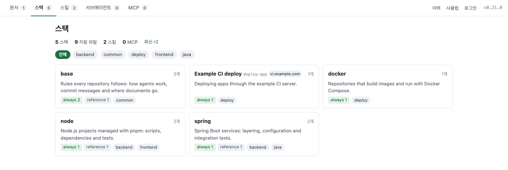

<!-- source: docs/manual/en/getting-started.md @ v0.27.0 -->
[English](../en/getting-started.md) | **한국어**

# 시작하기

`guideline` CLI 를 설치하는 것부터 프로젝트에 첫 지침을 받는 것까지 안내합니다.
[ruler](https://github.com/intellectronica/ruler) 를 쓰는 프로젝트가 있고 guideline-manage 를 처음 쓰는 개발자를 위한 문서입니다.

```text
지침 원본(서버 DB) ── 관리자 웹: 보기·편집·이력·토큰
        │
        ▼  guideline pick / update (로그인한 CLI)
프로젝트: .guideline/ 의 사본 + guideline.json(고른 항목) + guideline-lock.json(반영 기록)
        │
        ▼  guideline apply (서버가 필요 없음, pick·update 가 끝에 같은 일을 함)
ruler 가 읽을 생성물(.ruler/<스택>/, .ruler/guideline.md, docs/guideline/ …, git 이 무시함)
```

에이전트에게는 서버의 `/llms.txt`(예: `http://localhost:3000/llms.txt`)를 읽히세요. 이 매뉴얼을 에이전트용으로 줄인 것입니다.

## 시작하기 전에

- Node 24 이상이 필요합니다.
- 프로젝트가 ruler 를 써야 합니다. 그 디렉터리에 `.ruler/` 폴더가 있어야 합니다. 없으면 CLI 가 「ruler 프로젝트가 아님」 으로 멈춥니다. 기존 CLAUDE.md·AGENTS.md 지침을 먼저 `.ruler/` 로 옮기세요.
- 프로젝트 루트가 git 저장소여야 합니다.

## 1. CLI 설치

패키지를 설치하세요. `guideline` 명령이 생깁니다.

```bash
npm install -g guideline-manage
```

설치를 확인하세요.

```bash
guideline help
```

출력의 첫 줄이 사용법 줄입니다.

```text
사용법: guideline <명령> [옵션]
```

이 저장소의 클론에서 바로 쓰려면 `node <저장소>/cli/bin/guideline.js <명령>` 으로 부르거나, 저장소 루트에서 `pnpm link --global` 을 실행하세요.

셸 설정에 다음 줄을 넣으세요.

```bash
export GUIDELINE_LANG=ko                       # language of CLI messages and of text written into projects (default en)
export GUIDELINE_PROJECTS_DIR=~/IdeaProjects   # parent folder for new projects created by name alone
```

## 2. 지침 서버 띄우기

이미 떠 있는 서버를 쓰면 이 단계를 건너뛰세요.
이 저장소 클론의 루트에서 `.env` 를 만들고(git 이 무시합니다) 서버를 띄우세요.

```bash
cat > .env <<EOF
ADMIN_TOKEN=$(openssl rand -base64 48)
PUBLIC_URL=http://localhost:3000
DATA_DIR=./.data
GUIDELINE_LANG=ko
EOF
node --env-file=.env server/bin/guideline-server.js
```

데이터 폴더가 비어 있으면 로그에 씨앗과 포트가 나옵니다.

```text
seeded the empty server with ko guidelines (r1)
guideline-server listening on port 3000 (revision r1, http://localhost:3000)
```

- `ADMIN_TOKEN` 은 32자 이상이어야 합니다. 관리자 웹의 로그인 비밀번호 역할을 합니다. 바꾸면 모든 로그인 세션이 끊깁니다.
- 반드시 `PUBLIC_URL` 의 주소로 여세요. `127.0.0.1:3000` 처럼 다른 주소로 열면 로그인·저장이 거부됩니다.
- 데이터는 `.data/guideline.db` 파일 하나입니다. 시작할 때와 하루마다 `.data/backups/` 에 백업이 생깁니다. 새 버전으로 다시 띄우면 서버가 DB 를 백업한 뒤 스키마를 올립니다.
- `GUIDELINE_LANG` 은 관리자 웹과 빈 서버에 넣는 씨앗의 언어입니다. 기본값은 영어입니다.

새 서버에는 **씨앗**이 리비전 1 로 들어갑니다. 작성 규칙 `docs/authoring.md` 와 씨앗 스킬 `guideline-sync`·`guideline-export` 이며, 서버 언어로 쓰여 있습니다.
지침을 직접 채우려면 [지침 서버 배포하기](how-to/deploy-a-server.md#지침-채우기)를 보세요.

`http://localhost:3000` 을 여세요.
로그인 없이 스택·스킬·서브에이전트·MCP 서버를 볼 수 있습니다(`PUBLIC_READ=0` 이면 먼저 로그인해야 합니다).
편집·제안 검토·토큰 관리는 위쪽의 **로그인**을 눌러 관리자 토큰으로 로그인한 뒤 합니다.
위쪽의 **사용법**이 `/llms.txt` 를 보여 줍니다.



## 3. 로그인

머신마다 한 번 로그인하세요.

```bash
guideline login --server http://localhost:3000
```

브라우저가 열립니다.
관리자 웹에 로그인돼 있지 않으면 관리자 토큰으로 로그인한 뒤 **발급**을 누르세요.
터미널에 다음 줄들이 나오면 끝입니다.

```text
로그인 성공: http://localhost:3000 (cli-<호스트>-…)
토큰 범위: read
```

- CLI 는 읽기 토큰을 `~/.config/guideline/credentials.json`(권한 600)에 서버마다 따로 저장합니다.
- 원격 셸처럼 브라우저를 쓸 수 없는 곳에서는 웹 **토큰** 화면에서 토큰을 발급해 `guideline login --server <URL> --token-stdin` 으로 넣으세요.
- CI 에서는 환경 변수 `GUIDELINE_TOKEN` 을 쓰세요.
- 서버를 그만 쓸 때는 `guideline logout --server <URL>` 을 실행하세요. 로컬 토큰을 지우고 서버에서도 폐기합니다.

## 4. 프로젝트에 받을 지침 고르기

프로젝트 루트에서 `pick` 을 실행하세요.

```bash
cd ~/IdeaProjects/my-app
guideline pick --server http://localhost:3000
```

CLI 가 `guideline.json` 에 서버 주소를 남기므로 두 번째부터는 `--server` 를 빼도 됩니다.

CLI 가 서버에서 원본을 받아 `.guideline/` 의 사본과 비교합니다.
그 결과로 서버에 폼을 만들고 브라우저로 엽니다.
폼을 제출할 때까지 터미널은 기다립니다.

1. 폼 위쪽의 단계를 차례로 보세요: 지침 → MCP → 서브에이전트 → 스킬 → 확인. 고를 것이 없는 단계는 건너뜁니다.
2. 받을 항목을 체크하세요.
3. **확인** 단계에서 전체를 보고 제출하세요.

> [!WARNING]
> 프로젝트에 이미 있는 항목의 체크를 풀면 「제거」 입니다. 그 항목이 빨갛게 바뀌고 제출 버튼에 「제거 N 포함」 이 붙습니다.

항목 상태와 폼의 기능은 [고르기 폼](reference.md#고르기-폼)에 모두 있습니다.
고른 블록에 **고정**을 표시하면 누구도 자기에게서 그 블록을 빼지 못합니다.
프로젝트는 그대로 두고 내가 받는 것만 바꾸려면 `guideline pick --local` 을 쓰세요([내 머신에서만 지침 쓰기](how-to/use-guidelines-only-on-your-machine.md)).

## 5. 결과 확인과 커밋

제출하면 터미널에 쓴 파일, 지운 파일, **할 일**이 나옵니다.

```text
반영 완료(r3) — 쓴 파일 5, 지운 파일 1
  쓰기  .guideline/rules/base/01-git.md
  쓰기  .guideline/rules/mise/SETUP.md
  쓰기  .ruler/base/01-git.md
  쓰기  docs/guideline/mise/SETUP.md
  쓰기  .gitignore
  지우기  .guideline/rules/old-stack/02-notes.md
할 일
  - mise: 세팅 문서대로 세팅 — docs/guideline/mise/SETUP.md
```

할 일은 CLI 가 혼자 못 하는 일입니다. MCP 비밀값, 환경 변수, 세팅 문서, 이미 있는 파일과의 충돌 등이 있습니다.
직접 하거나 [에이전트에게 맡기세요](how-to/hand-off-to-an-agent.md).

받은 지침은 두 종류의 자리에 생깁니다.

| 무엇 | 자리 | git |
| --- | --- | --- |
| 받은 지침·세팅 문서·스킬·서브에이전트·MCP 서버의 사본(원본 그대로) | `.guideline/rules/<스택>/`, `.guideline/skills/<이름>/`, `.guideline/agents/`, `.guideline/mcp/<이름>/` | 커밋 |
| 바꿈 | `.guideline/overrides/<스택 경로>/` | 커밋 |
| 프로젝트의 ruler 설정(에이전트, `nested`, 직접 쓴 MCP 서버) | `.ruler/ruler.project.toml` | 커밋 |
| ruler 가 읽을 상시 지침 | `.ruler/<스택>/NN-*.md` | 생성물, git 이 무시함 |
| 참조 지침·세팅 문서 | `docs/guideline/<스택>/` + 색인 `.ruler/<스택>/99-reference.md` | 생성물, git 이 무시함 |
| 스킬·서브에이전트 | `.ruler/skills/`, `.ruler/agents/`(`ruler.project.toml` 에 `[agents] enabled = true` 일 때) | 생성물, git 이 무시함 |
| MCP | `.ruler/ruler.toml`(`ruler.project.toml` + 받은 MCP 서버) | 생성물, git 이 무시함 |
| 관리 지침 | `.ruler/guideline.md` | 생성물, git 이 무시함 |

CLI 가 `.guideline/` 에서 생성물을 조합하고 `.gitignore` 의 블록(`# START guideline generated files`)에 적습니다.
생성물은 고치지 마세요. 다음 `guideline apply` 가 덮어씁니다.
조합한 뒤에는 git 루트에서 `ruler apply` 가 돕니다.
프로젝트에 ruler 가 설치돼 있으면 CLI 가 돌리고, 없으면 할 일로 알립니다.

마지막으로 바뀐 파일을 확인하고 직접 커밋하세요: `.guideline/`, `guideline.json`, `guideline-lock.json`, `.ruler/ruler.project.toml`, `.gitignore`.
CLI 는 커밋하지 않습니다.

## 6. 새로 클론하거나 새 워크트리를 만들었을 때

생성물은 git 에 없으므로, 새로 클론했거나 새 워크트리를 만든 곳에는 `.ruler/<스택>/` 이 아직 없습니다.
거기서 `guideline apply` 를 실행하세요.
`.guideline/` 과 `.ruler/ruler.project.toml` 을 읽어 생성물을 쓰고 ruler 를 돌립니다. 서버에는 묻지 않습니다.
새 워크트리에서는 그 클론의 모든 워크트리가 함께 쓰는 [개인 선택](how-to/use-guidelines-only-on-your-machine.md)도 조합합니다.

```bash
guideline apply
```

```text
반영 완료(r3) — 쓴 파일 5, 지운 파일 0
  쓰기  .ruler/base/01-git.md
  …
```

설치할 때 자동으로 하려면 `guideline-manage` 를 개발 의존성으로 넣고 `package.json` 의 `prepare` 에서 `guideline apply` 를 부르세요.

```bash
pnpm add -D guideline-manage    # 또는: npm install -D, yarn add -D, bun add -d
```

```json
{ "scripts": { "prepare": "guideline apply" } }
```

`prepare` 가 `ruler apply` 를 돌고 있었다면 `guideline-manage` 가 의존성에 들어간 뒤 CLI 가 알아서 바꿉니다([서버와 CLI 올리기](how-to/upgrade.md#guideline-배치로-프로젝트-옮기기)).
`package.json` 이 없으면 CLI 가 `apply-hook` 할 일을 남깁니다. 세팅 단계에서 `guideline apply` 를 부르세요. 예를 들어 Orca 의 `orca.yaml` 에 있는 `scripts.setup` 입니다.

> [!WARNING]
> `guideline apply` 전에 `ruler apply` 만 돌리지 마세요. `.ruler/ruler.toml` 이 없으면 ruler 가 모든 에이전트 몫을 쓰고, 그 `CLAUDE.md` 를 Claude Code 가 `AGENTS.md` 대신 읽습니다.
> `guideline apply` 는 그런 파일을 지우고 알립니다([문제 해결](troubleshooting.md#cli)).

## 다음 문서

- [최신으로 유지하기](how-to/stay-up-to-date.md)
- [이 프로젝트에만 다르게 하기](how-to/override-guidelines.md)
- [내 머신에서만 지침 쓰기](how-to/use-guidelines-only-on-your-machine.md)
- [팀이 쓸 지침 서버 배포하기](how-to/deploy-a-server.md)
- [전체 문서](../README.md)
